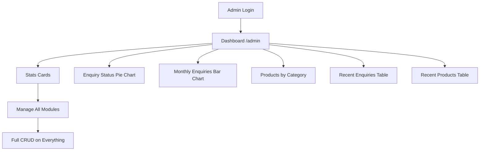
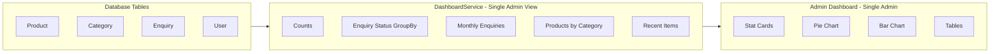
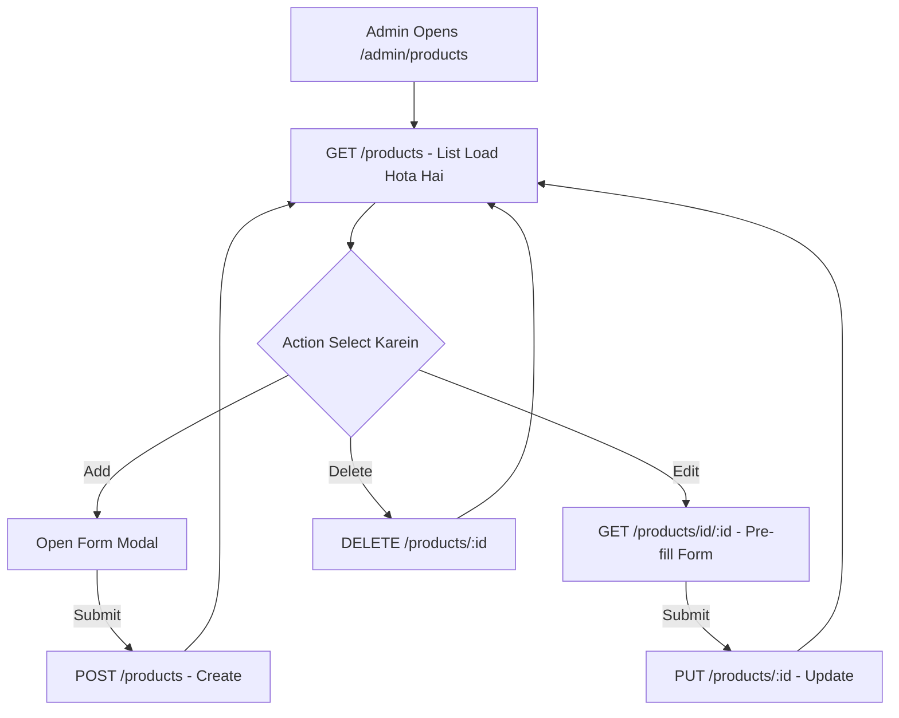
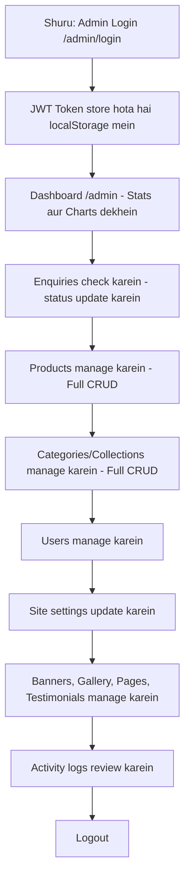

# Royal Shine — Admin Guide & CRUD Handbook (Single Admin)

> Premium jewellery e-commerce platform (Next.js + NestJS + Prisma + Neon PostgreSQL)
> Repo: `https://github.com/Trifusion-Dynamics/royal-shine.git`

> **Important:** Is system mein **ek hi admin role** hai jo sab kuch manage karta hai — products, categories, collections, enquiries, users, settings, banners, gallery, pages, testimonials aur activity logs. Koi alag role nahi hai. Ek admin = poora system.

---

## 1. GitHub PR Push Kaise Karein (Step-by-Step)

Niche diye gaye steps follow karein apne `main` branch mein changes push karne aur Pull Request (PR) kholne ke liye.

### Step A: Local repository setup

```bash
# Repo clone karein (pehle se hai toh skip karein)
git clone https://github.com/Trifusion-Dynamics/royal-shine.git
cd royal-shine

# Apne feature branch banayein (direct main par kaam na karein)
git checkout -b feature/your-feature-name
```

### Step B: Changes karke stage aur commit karein

```bash
# Kya badla hai dekhein
git status

# Sabhi changes stage karein (ya specific files)
git add .

# Commit karein meaningful message ke saath
git commit -m "feat: add product CRUD and admin dashboard"

# Branch ko remote par push karein
git push -u origin feature/your-feature-name
```

### Step C: GitHub par Pull Request kholein

1. Browser mein repo kholein: `https://github.com/Trifusion-Dynamics/royal-shine`
2. **"Compare & pull request"** button par click karein (apni pushed branch ko dekhkar aayega).
3. Base branch: `main`, Compare branch: `feature/your-feature-name` select karein.
4. Title aur description likhein.
5. **Create pull request** par click karein.
6. Reviewer assign karein, changes review hone ke baad **Merge pull request** karein.

### Quick Commands Cheat Sheet

| Karya | Command |
|-------|---------|
| Status dekhein | `git status` |
| Branch banayein | `git checkout -b branch-name` |
| Changes stage karein | `git add .` |
| Commit karein | `git commit -m "message"` |
| Push karein | `git push -u origin branch-name` |
| Pull latest main | `git pull origin main` |
| Log dekhein | `git log --oneline -10` |

---

## 2. Admin Kya Kya Dekh Sakta Hai? (Visibility)

Royal Shine admin dashboard (`/admin`) mein **single admin** login ke baad yeh sab dekh sakta hai:

| Module | Kya Dekh Sakta Hai | Route |
|--------|-------------------|-------|
| Dashboard | Total products, categories, collections, enquiries, users, recent activity | `/admin` |
| Products | Complete product catalogue with images, price, status, category | `/admin/products` |
| Categories | Category list, slug, image, status, sort order | `/admin/categories` |
| Collections | Collection list, featured status, product count | `/admin/collections` |
| Enquiries | Customer enquiries, mobile, status, assigned admin, notes | `/admin/enquiries` |
| Users | Registered users, role, email, admin flag | `/admin/users` |
| Settings | Site settings, social links, contact info, SEO | `/admin/settings` |
| Banners | Homepage banners, CTA, start/end dates | (via API) |
| Gallery | Jewellery gallery images | (via API) |
| Pages | Static pages (About, Contact, etc.) | (via API) |
| Testimonials | Customer reviews, rating, approval status | (via API) |
| Activity Logs | Admin actions (who changed what, when) | (via API) |

Single admin sab kuch dekh sakta hai — koi restriction nahi.

### Dashboard Charts (Visual)

- **Enquiry by Status** — Pie chart (new, contacted, in_progress, converted, closed)
- **Monthly Enquiries** — Bar chart (pichle 6 mahine)
- **Products by Category** — Data table (category-wise product count)
- **Recent Enquiries / Recent Products** — Tables

> Diagram: Admin dashboard flow



---

## 3. Admin Kya Kya Manage Kar Sakta Hai? (Full Access)

Ek hi admin sab kuch manage kar sakta hai. Koi alag role ya permission split nahi hai.

### Module-wise Full CRUD Access

| Module | Create | Read | Update | Delete | Backend Endpoint |
|--------|--------|------|--------|--------|------------------|
| Products | ✅ | ✅ | ✅ | ✅ | `POST/GET/PUT/DELETE /products` |
| Categories | ✅ | ✅ | ✅ | ✅ | `POST/GET/PUT/DELETE /categories` |
| Collections | ✅ | ✅ | ✅ | ✅ | `POST/GET/PUT/DELETE /collections` |
| Enquiries | ❌ (customer se aate hain) | ✅ | ✅ (status/notes) | ❌ | `GET/PATCH /enquiries` |
| Users | ✅ | ✅ | ✅ (profile/role) | ❌ | `GET/PUT /users` |
| Banners | ✅ | ✅ | ✅ | ✅ | `POST/GET/PUT/DELETE /banners` |
| Gallery | ✅ | ✅ | ✅ | ✅ | `POST/GET/PUT/DELETE /galleries` |
| Pages | ✅ | ✅ | ✅ | ✅ | `POST/GET/PUT/DELETE /pages` |
| Testimonials | ✅ | ✅ | ✅ | ✅ | `POST/GET/PUT/DELETE /testimonials` |
| Settings | ✅ | ✅ | ✅ | ❌ | `GET/PUT /settings` |
| Activity Logs | ❌ | ✅ | ❌ | ❌ | `GET /activity-logs` |

**Single admin permissions:**
- ✅ Sab modules ka full access
- ✅ Sab kuch create kar sakta hai (except enquiries jo customer se aate hain)
- ✅ Sab kuch read kar sakta hai
- ✅ Sab kuch update kar sakta hai
- ✅ Products, categories, collections, banners, gallery, pages, testimonials delete kar sakta hai
- ✅ Enquiries ka status aur notes update kar sakta hai
- ✅ Users ka profile aur role update kar sakta hai

---

## 4. Admin Kaunse Analysis Kar Sakta Hai? (Analysis & Reports)

Dashboard service (`backend/src/modules/dashboard/dashboard.service.ts`) neeche diye gaye analysis provide karta hai. Single admin in sab ko dekh sakta hai.

### Analysis Types

| Analysis | Kya Bataata Hai | Chart / Table |
|----------|----------------|---------------|
| Total Products | Catalogue ka size | Stat card |
| Published / Draft / Inactive Products | Product status distribution | Stat cards |
| Total Categories / Collections | Catalogue structure | Stat cards |
| Total Enquiries | Customer interest volume | Stat card |
| New Enquiries | Fresh leads needing action | Stat card |
| Pending vs Resolved Enquiries | Support workload | Stat cards |
| Enquiry by Status | Status-wise enquiry split | Pie chart |
| Monthly Enquiries (6 months) | Trend over time | Bar chart |
| Products by Category | Kaunse category mein sabse zyada products hain | Table / Bar |
| Recent Enquiries | Latest 5 customer messages | Table |
| Recent Products | Latest 5 catalogue additions | Table |

> Analysis flow diagram



---

## 5. Products Me CRUD Operations Kaise Karein

Product module `backend/src/modules/products/` mein hai. Single admin in sab operations ko perform kar sakta hai.

### Product Data Model (Prisma)

```prisma
model Product {
  id                Int       @id @default(autoincrement())
  category_id       Int
  collection_id     Int?
  name              String
  slug              String    @unique
  sku               String    @unique
  short_description String?
  description       String?
  metal_type        MetalType?
  gold_purity       GoldPurity?
  weight            Float?
  weight_unit       String?
  stone_details     String?
  price             Float?
  price_on_request  Boolean   @default(false)
  is_featured       Boolean   @default(false)
  status            ProductStatus @default(draft)
  seo_title         String?
  seo_description   String?
  sort_order        Int       @default(0)
  category          Category  @relation(fields: [category_id], references: [id])
  collection        Collection? @relation(fields: [collection_id], references: [id])
  images            ProductImage[]
  created_at        DateTime  @default(now()) @map("created_at")
  updated_at        DateTime  @updatedAt @map("updated_at")
}

enum ProductStatus {
  draft
  published
  inactive
}

enum MetalType { gold silver artificial other }
enum GoldPurity { K9 @map("9K") K14 @map("14K") K18 @map("18K") K22 @map("22K") }
```

---

### 5.1 CREATE — Product Banayein

**Endpoint:** `POST /products`  
**Auth:** Bearer JWT  
**Role:** Single Admin (full access)

```bash
curl -X POST http://localhost:4000/api/v1/products \
  -H "Authorization: Bearer <JWT_TOKEN>" \
  -H "Content-Type: application/json" \
  -d '{
    "name": "Gold Necklace Set",
    "slug": "gold-necklace-set",
    "sku": "GN-001",
    "category_id": 1,
    "collection_id": null,
    "short_description": "22K gold necklace with pendant",
    "description": "Premium 22K gold jewellery set for weddings",
    "metal_type": "gold",
    "gold_purity": "22K",
    "weight": 12.5,
    "weight_unit": "grams",
    "stone_details": "None",
    "price": 85000,
    "price_on_request": false,
    "is_featured": true,
    "status": "published",
    "seo_title": "Gold Necklace Set - Royal Shine",
    "seo_description": "Buy 22K gold necklace set online",
    "sort_order": 1,
    "images": [
      { "image": "https://ik.imagekit.io/.../necklace1.jpg", "altText": "Gold necklace front", "isPrimary": true, "sortOrder": 1 },
      { "image": "https://ik.imagekit.io/.../necklace2.jpg", "altText": "Gold necklace side", "isPrimary": false, "sortOrder": 2 }
    ]
  }'
```

**Frontend (React/Next.js):**

```tsx
await api.post('/products', formData);
// formData mein name, slug, sku, category_id, price, status, images, etc. hote hain
```

**Response (success):**
```json
{
  "data": {
    "id": 101,
    "name": "Gold Necklace Set",
    "slug": "gold-necklace-set",
    "sku": "GN-001",
    "status": "published",
    "price": 85000,
    "images": [...],
    "category": { "id": 1, "name": "Necklaces", "slug": "necklaces" },
    "created_at": "2026-11-18T..."
  },
  "message": null
}
```

**Error cases:**
- Slug ya SKU pehle se maujood hai → `409 Conflict: Product with this slug or SKU already exists`

---

### 5.2 READ — Product Dekhein / List Karein

#### A) All Products (Public, paginated)

```bash
curl "http://localhost:4000/api/v1/products?page=1&limit=20&search=gold&status=published&metal_type=gold&min_price=50000&max_price=150000"
```

**Query Params:** `page, limit, search, categoryId, categorySlug, collectionId, collectionSlug, status, metalType, goldPurity, minPrice, maxPrice, isFeatured, sortBy, sortOrder`

#### B) Single Product by Slug (Public)

```bash
curl http://localhost:4000/api/v1/products/gold-necklace-set
```

#### C) Single Product by ID (Public)

```bash
curl http://localhost:4000/api/v1/products/id/101
```

#### D) Featured / New Arrivals (Public)

```bash
curl http://localhost:4000/api/v1/products/featured
curl http://localhost:4000/api/v1/products/new-arrivals
```

**Frontend example:**
```tsx
const res = await api.get('/products?limit=100');
const products = res.data.data;
```

> CRUD flow diagram for Products



---

### 5.3 UPDATE — Product Update Karein

**Endpoint:** `PUT /products/:id`  
**Auth:** Bearer JWT  
**Role:** Single Admin (full access)

```bash
curl -X PUT http://localhost:4000/api/v1/products/101 \
  -H "Authorization: Bearer <JWT_TOKEN>" \
  -H "Content-Type: application/json" \
  -d '{
    "name": "Gold Necklace Set - Updated",
    "price": 89999,
    "status": "published",
    "is_featured": false
  }'
```

**Frontend:**
```tsx
await api.put(`/products/${editing.id}`, form);
```

**Logic (backend `products.service.ts:185`):**
1. Product exist karta hai ya nahi check karein (`findById`)
2. Slug/SKU duplicate na ho check karein (same id ko exclude karke)
3. Agar `images` provide kiya ho toh purane images delete karke naye create karein (`$transaction`)
4. Product update karein aur return karein

---

### 5.4 DELETE — Product Delete Karein

**Endpoint:** `DELETE /products/:id`  
**Auth:** Bearer JWT  
**Role:** Single Admin (full access)

```bash
curl -X DELETE http://localhost:4000/api/v1/products/101 \
  -H "Authorization: Bearer <JWT_TOKEN>"
```

**Frontend:**
```tsx
if (window.confirm('Delete this product?')) {
  await api.delete(`/products/${id}`);
  fetchProducts();
}
```

**Response:** `{ "message": "Product deleted successfully" }`

---

### 5.5 Products CRUD Summary Table

| Operation | HTTP Method | Endpoint | Auth | Role |
|-----------|-------------|----------|------|------|
| List | `GET` | `/products` | Public | All |
| Get by slug | `GET` | `/products/:slug` | Public | All |
| Get by id | `GET` | `/products/id/:id` | Public | All |
| Featured | `GET` | `/products/featured` | Public | All |
| New arrivals | `GET` | `/products/new-arrivals` | Public | All |
| Create | `POST` | `/products` | JWT | Single Admin |
| Update | `PUT` | `/products/:id` | JWT | Single Admin |
| Delete | `DELETE` | `/products/:id` | JWT | Single Admin |

---

## 6. Sab Kaise Karein? (End-to-End Workflow)

### Admin Daily Workflow (Single Admin)



### Complete Steps

1. **Login:** `/admin/login` par email + password se sign in karein. Token `royal_shine_token` key mein save hota hai.
2. **Dashboard dekhein:** `/admin` par jayein. Stats cards, pie chart, bar chart, recent tables dekhein.
3. **Enquiries manage karein:** `/admin/enquiries` par jayein. Enquiry ka status `new` → `contacted` → `in_progress` → `converted/closed` change karein. Internal notes add karein.
4. **Products manage karein:** `/admin/products` par jayein.
   - **Add:** "Add Product" button → form fill → Create Product.
   - **Edit:** Edit icon → form pre-fill → Update Product.
   - **Delete:** Delete icon → confirm → Product delete.
5. **Categories/Collections:** `/admin/categories` aur `/admin/collections` par manage karein (full CRUD).
6. **Users:** `/admin/users` par users ka profile aur role manage karein.
7. **Settings:** `/admin/settings` par site logo, phone, whatsapp, email, social links update karein.
8. **Banners/Gallery/Pages/Testimonials:** In sab ko manage karein (full CRUD).
9. **Analysis:** Dashboard charts se faisla lein ki kaunse products zyada bante hain, kaunse enquiries pending hain.

---

## 7. Frontend Admin Routes (Quick Reference)

| Route | Component | Kya Karta Hai |
|-------|-----------|---------------|
| `/admin/login` | `admin/login/page.tsx` | Admin sign-in |
| `/admin` | `admin/page.tsx` | Dashboard with charts & stats |
| `/admin/products` | `admin/products/page.tsx` | Product CRUD (list, add, edit, delete) |
| `/admin/categories` | `admin/categories/page.tsx` | Category management (full CRUD) |
| `/admin/collections` | `admin/collections/page.tsx` | Collection management (full CRUD) |
| `/admin/users` | `admin/users/page.tsx` | User management |
| `/admin/enquiries` | `admin/enquiries/page.tsx` | Enquiry management |
| `/admin/settings` | `admin/settings/page.tsx` | Site settings |

Single admin in sab routes ko access kar sakta hai.

---

## 8. Backend Modules (Quick Reference)

| Module | Folder | Controller | Service | Access |
|--------|--------|------------|---------|--------|
| Products | `backend/src/modules/products/` | `products.controller.ts` | `products.service.ts` | Single Admin |
| Dashboard | `backend/src/modules/dashboard/` | `dashboard.controller.ts` | `dashboard.service.ts` | Single Admin |
| Categories | `backend/src/modules/categories/` | `categories.controller.ts` | `categories.service.ts` | Single Admin |
| Collections | `backend/src/modules/collections/` | `collections.controller.ts` | `collections.service.ts` | Single Admin |
| Enquiries | `backend/src/modules/enquiries/` | `enquiries.controller.ts` | `enquiries.service.ts` | Single Admin |
| Users | `backend/src/modules/users/` | `users.controller.ts` | `users.service.ts` | Single Admin |
| Auth | `backend/src/modules/auth/` | `auth.controller.ts` | `auth.service.ts` | Public + JWT |

Single admin ke liye sabhi backend modules accessible hain.

---

## 9. Security & Best Practices

1. **JWT Token:** Har protected request mein `Authorization: Bearer <token>` header add karein.
2. **Single Admin Access:** Ek hi admin role hai jo sab kuch manage karta hai — koi role split nahi hai.
3. **No Secrets in Code:** Kabhi bhi `.env` ya production secrets commit na karein (`.gitignore` mein hai).
4. **Validation:** DTOs (Data Transfer Objects) se request body validate hoti hai (class-validator).
5. **Slug/SKU Unique:** Product create/update mein slug aur sku unique hona chahiye, warna `409 Conflict` aayega.
6. **Database Backup:** Production mein destructive migrations se pehle backup lein.

---

## 10. Useful Commands

```bash
# Install dependencies
pnpm install

# Generate Prisma client
pnpm --filter backend prisma:generate

# Run dev (frontend + backend)
pnpm dev

# Backend only
pnpm --filter backend start:dev

# Frontend only
pnpm --filter frontend dev

# Build
pnpm build

# Lint
pnpm lint
```

**URLs (local dev):**
- Storefront: `http://localhost:3000`
- API: `http://localhost:4000/api/v1`
- Swagger Docs: `http://localhost:4000/api/docs`
- Admin Login: `http://localhost:3000/admin/login`

---

> **Note:** Yeh guide Royal Shine codebase (`main` branch) ke hisaab se banayi hai. Isme **ek hi admin role** hai jo sab kuch manage karta hai. Agar code mein badlav ho toh is guide ko update karein.
