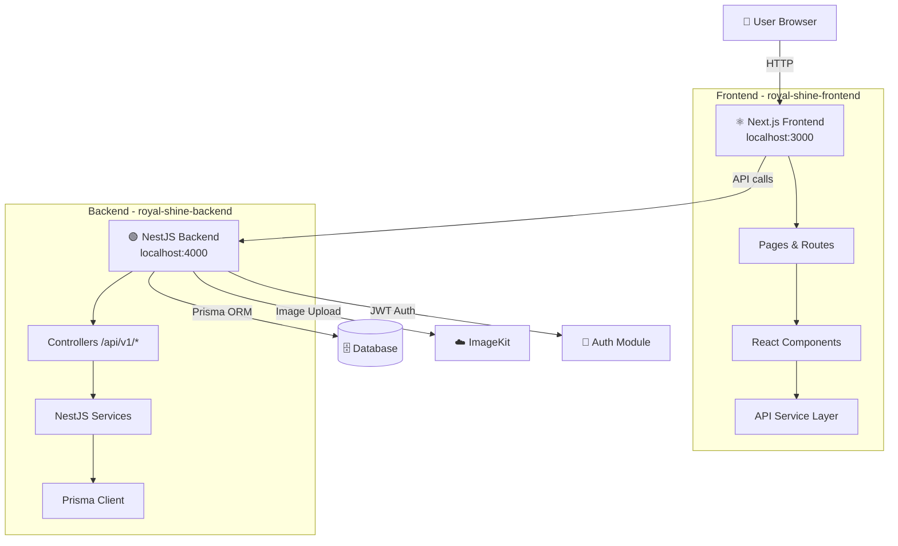

# Royal Shine — Project Status & Fixes

## Current Status

| Command | Status | Detail |
|---------|--------|--------|
| `pnpm build` | ✅ Working | Frontend (Next.js) + Backend (NestJS) both compile successfully |
| `pnpm dev` | ✅ Working | Frontend on `localhost:3000`, Backend on `localhost:4000` |

## Fixes Applied

### 1. Wrong workspace filter names (`package.json:10`)
The root `build` script used invalid filter names (`frontend`/`backend`) that did not match the workspace package names. Changed to the correct filter names:

```json
"build": "pnpm --filter royal-shine-frontend build && pnpm --filter royal-shine-backend build"
```

### 2. Missing `concurrently` dependency
`concurrently` was declared in root `devDependencies` but not installed in `node_modules`, causing `pnpm dev` to crash with `MODULE_NOT_FOUND`. Ran `pnpm install` to install it.

### 3. Unclosed JSX div (`frontend/src/app/product/[slug]/ProductClient.tsx`)
`<div className="container-luxury">` (opened at line 101) was never closed before `</section>`, causing the Next.js production build to fail with a parse error. Added the missing closing `</div>`.

### 4. Prisma Client not generated
`prisma generate` had not been run (Prisma build scripts were skipped during install), so the NestJS backend dev server crashed with:
```
Error: Cannot find module '.prisma/client/default'
```
Ran `pnpm --filter royal-shine-backend prisma:generate` to generate the Prisma client.

## Architecture



## Project Structure

```
royal-shine/
├── package.json              # Root scripts: dev, build, lint
├── pnpm-workspace.yaml       # Workspace: frontend, backend
├── frontend/                 # Next.js 15 (Port 3000)
│   ├── src/app/              # App Router pages
│   └── package.json
└── backend/                  # NestJS 10 (Port 4000)
    ├── src/                  # Controllers, Services, Modules
    ├── prisma/               # Prisma schema & migrations
    └── package.json
```

## How to Run

```bash
# Install dependencies
pnpm install

# Generate Prisma client (required for backend)
pnpm --filter royal-shine-backend prisma:generate

# Build both frontend and backend
pnpm build

# Start both servers in development
pnpm dev
```

- Frontend: `http://localhost:3000`
- Backend API: `http://localhost:4000`
