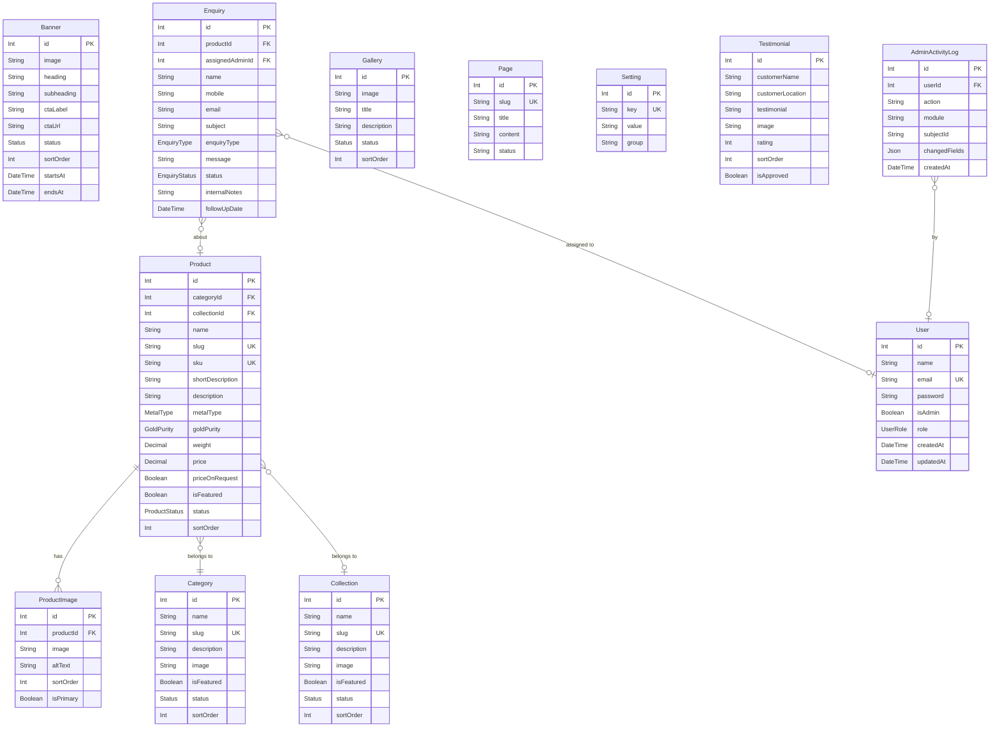

# Architecture — Royal Shine

> Next.js 15 + NestJS + Neon PostgreSQL + Cloudinary

---

## 1. System Overview

Royal Shine is a **premium jewellery catalogue** (no cart or payments). The application is split into two independently deployable services that share a Neon PostgreSQL database and Cloudinary media storage.

| Component | Technology | Port |
|---|---|---|
| Frontend | Next.js 15, React 19, TypeScript, Tailwind CSS | 3000 |
| Backend API | NestJS, TypeScript, Prisma ORM | 4000 |
| Database | Neon PostgreSQL (serverless) | 5432 |
| Media CDN | Cloudinary | — |

---

## 2. Folder Structure

```
royal-shine/
├── frontend/                    # Next.js 15 (App Router)
│   ├── src/
│   │   ├── app/
│   │   │   ├── (public)/        # Public catalogue pages
│   │   │   │   ├── page.tsx     # Home
│   │   │   │   ├── products/    # Catalogue listing + detail
│   │   │   │   ├── collections/ # Collection pages
│   │   │   │   ├── categories/  # Category pages
│   │   │   │   ├── gallery/     # Gallery page
│   │   │   │   └── contact/     # Contact/enquiry form
│   │   │   └── admin/           # Admin panel (private)
│   │   │       ├── login/
│   │   │       ├── dashboard/
│   │   │       ├── products/
│   │   │       ├── categories/
│   │   │       ├── collections/
│   │   │       ├── banners/
│   │   │       ├── enquiries/
│   │   │       ├── gallery/
│   │   │       ├── pages/
│   │   │       ├── settings/
│   │   │       ├── testimonials/
│   │   │       └── users/
│   │   ├── components/
│   │   │   ├── ui/              # Reusable primitives (Button, Input…)
│   │   │   ├── layout/          # Header, Footer, AdminSidebar
│   │   │   └── sections/        # Page-level sections (HeroBanner, etc.)
│   │   ├── lib/
│   │   │   ├── api.ts           # Axios instance + interceptors
│   │   │   └── utils.ts
│   │   └── types/               # Shared TypeScript interfaces
│   ├── public/
│   └── package.json
│
├── backend/                     # NestJS API
│   ├── src/
│   │   ├── main.ts              # Bootstrap (Swagger, CORS, pipes)
│   │   ├── app.module.ts
│   │   ├── config/              # ConfigModule, env validation
│   │   ├── common/
│   │   │   ├── decorators/      # @CurrentUser, @Roles, @Public
│   │   │   ├── filters/         # GlobalExceptionFilter
│   │   │   ├── guards/          # JwtAuthGuard, RolesGuard
│   │   │   ├── interceptors/    # TransformInterceptor, LoggingInterceptor
│   │   │   └── middleware/      # RequestLogger
│   │   └── modules/
│   │       ├── auth/            # JWT login, /me
│   │       ├── products/        # Product CRUD + slug lookup
│   │       ├── categories/
│   │       ├── collections/
│   │       ├── banners/
│   │       ├── enquiries/
│   │       ├── galleries/
│   │       ├── pages/
│   │       ├── settings/
│   │       ├── testimonials/
│   │       ├── users/
│   │       ├── upload/          # Cloudinary upload
│   │       └── dashboard/       # Stats aggregation
│   ├── prisma/
│   │   └── schema.prisma
│   └── package.json
│
└── docs/                        # This documentation
```

---

## 3. Request Flow Diagram

### Public Catalogue Request

```
Browser
  │
  ▼
Next.js App Router (port 3000)
  │  Server Component calls fetch()
  ▼
NestJS API (port 4000)
  │  /api/v1/products?status=published
  ▼
Prisma ORM
  │
  ▼
Neon PostgreSQL (cloud)
  │
  ◄─── result rows ────────────────────
  │
NestJS serialises → JSON response
  │
Next.js caches (ISR / React cache)
  │
  ▼
HTML rendered → Browser
```

### Admin Write Request

```
Admin Browser
  │
  ▼
Next.js Admin Page (client component)
  │  POST /api/v1/admin/products  +  Authorization: Bearer <JWT>
  ▼
NestJS → JwtAuthGuard → RolesGuard
  │  token valid + role == admin/super_admin
  ▼
ProductsService.create(dto)
  │
  ▼
Prisma → INSERT INTO products
  │
  ◄─── { id, slug, … } ────────────────
  │
201 Created → Admin UI refresh
```

---

## 4. Authentication Flow (JWT)

```
POST /api/v1/auth/login
  { email, password }
        │
        ▼
  UsersService.findByEmail()
  bcrypt.compare(password, hash)
        │
   valid?──No──► 401 Unauthorized
        │
       Yes
        ▼
  JwtService.sign({ sub: userId, role })
        │
        ▼
  { accessToken, user }  ← stored in localStorage / httpOnly cookie
        │
        ▼ (subsequent requests)
  Authorization: Bearer <token>
        │
        ▼
  JwtAuthGuard.canActivate()
    JwtStrategy.validate() → user object injected
        │
        ▼
  RolesGuard checks @Roles(…) decorator
        │
   authorized? ──No──► 403 Forbidden
        │
       Yes
        ▼
  Controller handler executes
```

### Role Hierarchy

| Role | Access |
|---|---|
| `super_admin` | Full access — all modules including user management |
| `admin` | Full access except user management |
| `content_manager` | Products, categories, collections, banners, gallery, pages |
| `enquiry_manager` | Enquiries only |

---

## 5. Image Management Flow (Cloudinary)

```
Admin uploads image file
        │
        ▼
POST /api/v1/admin/upload
  multipart/form-data
        │
        ▼
NestJS UploadModule
  Multer (memory storage, 10 MB limit)
        │
        ▼
Cloudinary SDK
  cloudinary.uploader.upload(buffer, {
    folder: 'royal-shine/<module>',
    transformation: [{ width: 1200, quality: 'auto', fetch_format: 'auto' }]
  })
        │
        ▼
  { secure_url, public_id }
        │
        ▼
  Response: { url, publicId }
        │
Admin stores URL in product/banner/gallery record
        │
        ▼
Cloudinary CDN delivers optimised WebP/AVIF to browsers
```

---

## 6. Role-Based Access Control

| Endpoint group | PUBLIC | enquiry_manager | content_manager | admin | super_admin |
|---|---|---|---|---|---|
| GET /products, /categories, /collections | ✅ | ✅ | ✅ | ✅ | ✅ |
| GET /banners, /gallery, /testimonials | ✅ | ✅ | ✅ | ✅ | ✅ |
| POST /enquiries | ✅ | ✅ | ✅ | ✅ | ✅ |
| GET /admin/enquiries | ❌ | ✅ | ✅ | ✅ | ✅ |
| PUT /admin/enquiries/:id | ❌ | ✅ | ✅ | ✅ | ✅ |
| Admin CRUD — products/categories/etc. | ❌ | ❌ | ✅ | ✅ | ✅ |
| POST /admin/upload | ❌ | ❌ | ✅ | ✅ | ✅ |
| GET /admin/dashboard/stats | ❌ | ❌ | ❌ | ✅ | ✅ |
| /admin/users (CRUD) | ❌ | ❌ | ❌ | ❌ | ✅ |
| PUT /admin/settings | ❌ | ❌ | ❌ | ✅ | ✅ |

---

## 7. Database ER Diagram



---

## 8. Environment Variables Reference

### Backend (`backend/.env`)

| Variable | Required | Description |
|---|---|---|
| `DATABASE_URL` | ✅ | Neon PostgreSQL connection string |
| `JWT_SECRET` | ✅ | Secret for signing JWT tokens |
| `JWT_EXPIRES_IN` | ✅ | Token TTL (e.g. `7d`) |
| `CLOUDINARY_CLOUD_NAME` | ✅ | Cloudinary cloud name |
| `CLOUDINARY_API_KEY` | ✅ | Cloudinary API key |
| `CLOUDINARY_API_SECRET` | ✅ | Cloudinary API secret |
| `PORT` | ❌ | API port (default: `4000`) |
| `NODE_ENV` | ❌ | `development` or `production` |
| `CORS_ORIGIN` | ❌ | Allowed origin (default: `http://localhost:3000`) |

### Frontend (`frontend/.env.local`)

| Variable | Required | Description |
|---|---|---|
| `NEXT_PUBLIC_API_URL` | ✅ | Backend API base URL |
| `NEXT_PUBLIC_CLOUDINARY_CLOUD_NAME` | ✅ | For client-side Cloudinary URLs |
